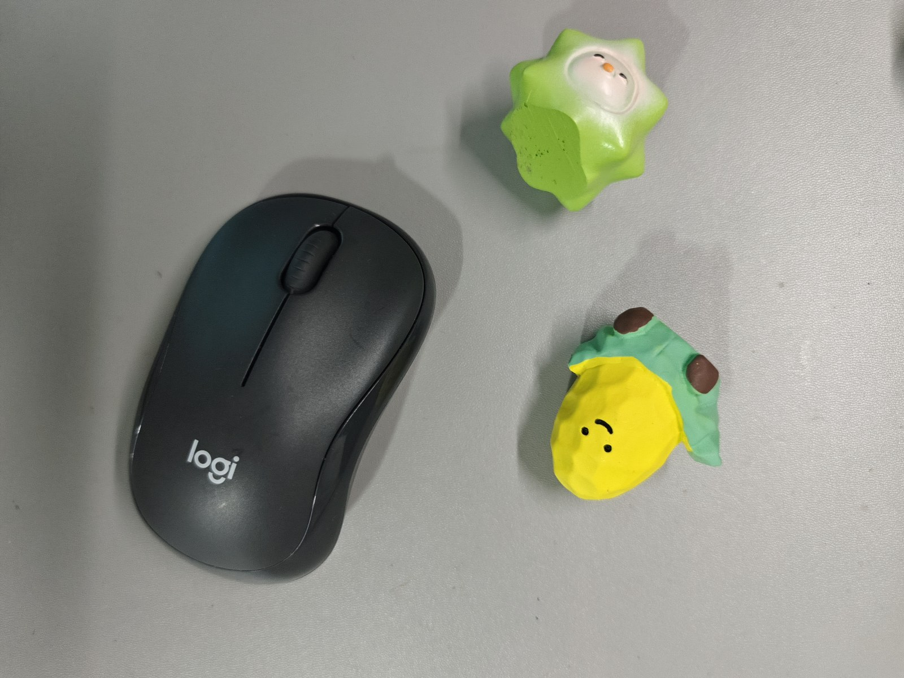
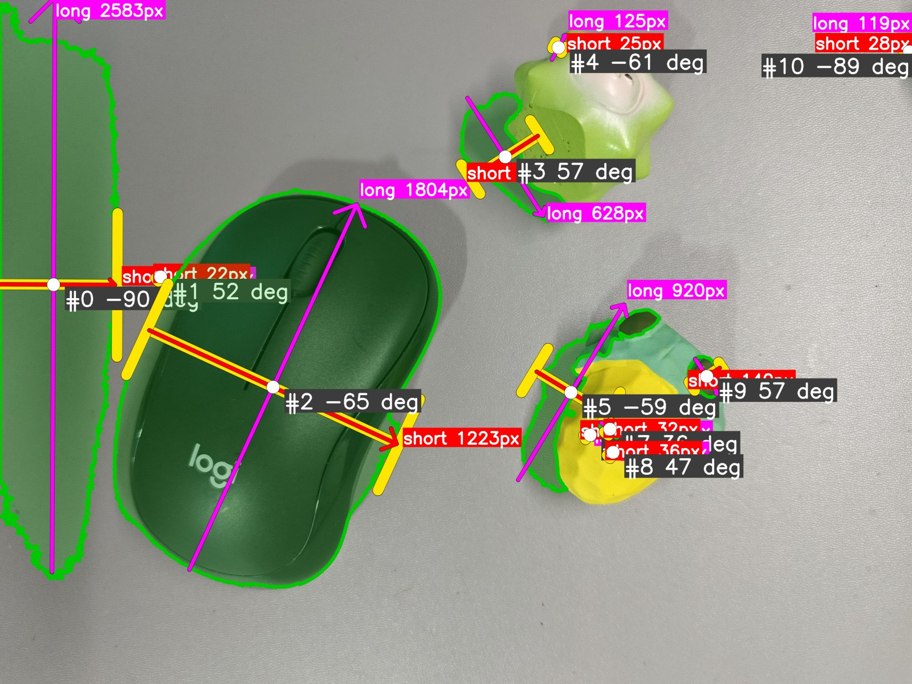
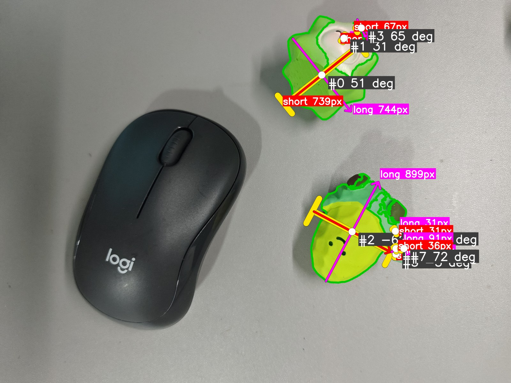
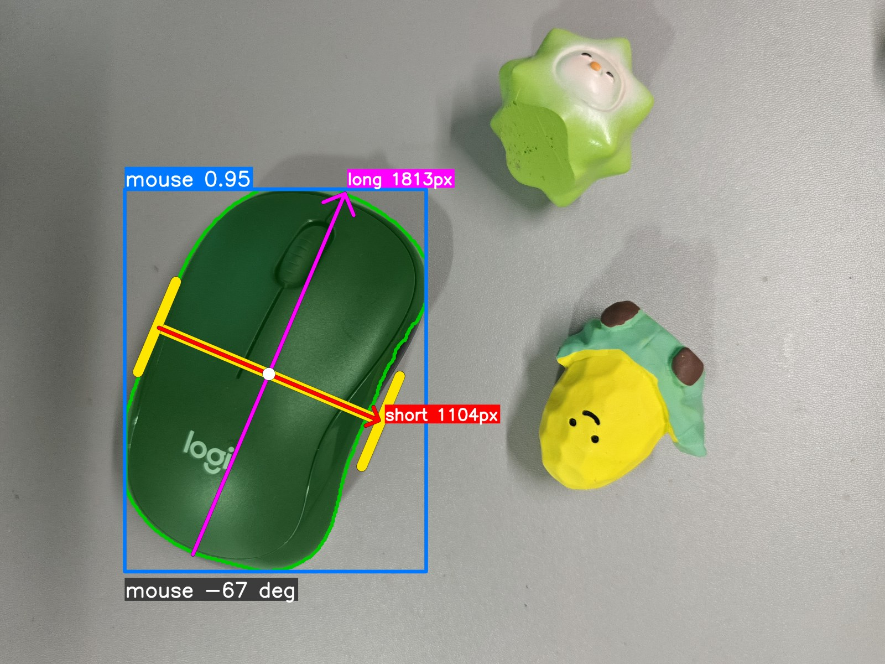

# Object Pose Estimation (Track 1)

> Date: 2026-11-12

Simple 2D object pose estimator:
**threshold → `cv2.findContours` → PCA → parallel-jaw gripper on the short axis.**

## Install

```bash
python -m venv .venv && .venv\Scripts\activate      # Windows
pip install -r requirements.txt
pip install ultralytics                              # optional, for YOLO mode
```

## Usage

```bash
python make_sample.py                                # synthetic image with known angles
python main.py --image data/sample.png               # grayscale + Otsu (auto-invert)
python main.py --image data/my_table.jpg --invert    # dark objects on a bright table
python main.py --image data/my_table.jpg --mode color --lower 35 60 60 --upper 85 255 255
python main.py --image data/my_table.jpg --mode bg   # uniform table, any object colour (dark / bright / coloured)
python main.py --image data/my_table.jpg --mode bg --hull --drop-border   # fill notches, drop edge artefacts
python main.py --image data/my_table.jpg --mode yolo --conf 0.1   # next step: YOLO segmentation + same PCA; box + class + confidence, lower --conf finds more
pytest -q                                            # unit tests
```

Outputs go to `results/`: `*_pose.png` (overlay), `*_mask.png` (all modes, including YOLO), `*_poses.json`.

Overlay legend: **magenta arrow = long axis**, **red arrow = short axis**, **yellow = parallel-jaw gripper** (two fingers + bar, closes along the short axis), green = object mask, blue box = YOLO detection (`class confidence`).

## Algorithm

| Step | Function | Notes |
|---|---|---|
| 1. Segment | `segment_gray` / `segment_color` / `segment_background` / `clean_mask` | Otsu on gray; HSV `inRange`; or `bg`: Lab distance to a fitted table-colour surface (finds dark, bright and coloured objects, ignores vignetting); morphology open/close |
| 2. Separate objects | `split_objects` | `cv2.findContours` (external), filled per-contour mask, `min_area` filter |
| 3. PCA | `pca_pose` | covariance of object pixels (x, y) → eigenvectors; 1st = long axis, 2nd = short axis |
| 4. Gripper | `gripper_geometry`, `draw_pose` | jaws at ±(short_len/2 + margin) along the short axis, fingers parallel to long axis |

**Input:** BGR image. **Output per object:** centre (x, y), long/short axis unit vectors, extents along each axis (px), angle of long axis (deg, image coords, y down), area.

> **Axis order:** NumPy is (row, col) = (y, x); OpenCV is (x, y). The only place that swaps is `mask_to_xy()`; everything else stays (x, y). If your gripper draws in the wrong place, check there first.

**About YOLO output:** each detection is drawn with a box labelled `class confidence`. Confidence is per detection (0-1); mAP is a dataset-level metric computed against labelled ground truth, so it cannot be shown on a single image. A COCO-pretrained model only knows 80 classes, so other objects (e.g. toys) are not detected.

## Results on my own photo

Test image `data/my_table.jpg` (4096 × 3072): a black Logitech mouse and two small coloured toys (green, yellow) on a light-grey desk. The same image goes through the same PCA + gripper step; **only the segmentation changes**. Figures below are downscaled copies (`docs/figures/`); full-resolution overlays, masks and JSON are in `results/`.



### 1. Grayscale threshold (`--mode gray`)



- **Finds objects of very different colours.** The black mouse and both toys are picked up because the method only needs a brightness difference from the table, so there is no colour range to tune.
- **Also picks up shadows and dark regions.** The largest false detection (#0, ~1.09 M px, long axis 2583 px) is the dark shaded strip along the left edge of the photo, which is simply darker than the rest of the desk.
- **Over-segmentation.** 11 detections for 3 real objects: 1 shaded region + 7 small fragments (584 – 2566 px) around the toys and at the image edge. The toys are also only partly covered: their bright parts are close to the table's brightness and fall on the background side of the threshold.
- The mouse (#2) is segmented well: angle −65.4°, long axis 1804 px.

### 2. Colour threshold (`--mode color`)



- **Only finds colours inside the HSV range.** Both toys are found, but the **black mouse is missed completely**: black, white and grey objects have almost no saturation, so no hue range can describe them. Covering several colours needs several ranges, and a range tuned for green would miss the yellow toy.
- **Over-segmentation.** 8 detections for 2 real objects: the green toy is split into 3 pieces (#0, #1, #3) and the yellow toy into 5 (#2 plus four small blobs). Differently coloured parts (the toy's white face, the green clothes on the yellow toy, the dark brown shoes) fall outside the range and cut the object apart.
- **Fragments give meaningless poses.** The three pieces of the green toy report 51°, 31° and 65°, although it is a single object.

### 3. YOLO segmentation (`--mode yolo`, `yolov8n-seg.pt`)



- **One clean instance per recognised object.** The mouse is detected as `mouse` with confidence 0.948, one mask and one box: angle −67.2°, long axis 1813 px, short axis 1104 px. No shadow, no fragments.
- **Only detects what it was trained on.** The model is pretrained on COCO (80 classes) and "mouse" is one of them; the two toys belong to no class, so they are not detected at all.
- The mask comes from a polygon at model resolution, so its boundary is a little rougher than a threshold mask.

### Comparison

| | Gray | Color | YOLO |
|---|---|---|---|
| Detections | 11 | 8 | 1 |
| Real objects found (of 3) | 3, toys only partly | 2 (toys), mouse missed | 1 (mouse), toys missed |
| False / fragment detections | 8 (1 shaded region + 7 fragments) | 6 fragments | 0 |
| Sees black / white / grey objects | yes | no | if the class is known |
| Fooled by shadows / dark edges | yes | mostly no | no |
| Splits one object into several | yes | yes | no |
| Needs tuning | threshold, invert | HSV range per colour | model, `--conf`, class list |
| Mouse angle / long axis | −65.4° / 1804 px | – | −67.2° / 1813 px |

### Findings

1. **Thresholding asks "does this pixel look like the table?", not "what is an object?"** Shadows count as objects, and an object whose surface varies (face, highlight, clothes) breaks into pieces. `findContours` turns every connected piece into its own object, and PCA on a fragment returns an axis that has nothing to do with the real object.
2. **Gray and colour fail in opposite ways.** Gray sees every kind of colour but also the shadows; colour ignores the shadows but is blind to black / white / grey and to anything outside its range.
3. **YOLO is robust but closed-set.** Where it recognises an object it gives a clean, whole mask and a confidence score; for anything outside its training classes it silently returns nothing.
4. **PCA itself is not the weak point.** When the mask is good, the very different methods agree: gray and YOLO differ by only 1.8° on the mouse.

Possible next steps: merge fragments (morphological closing, minimum-area filter), model the table background (`--mode bg`), fine-tune YOLO on the toys or use open-vocabulary / promptable segmentation (e.g. YOLO-World, SAM).

## Layout

```
main.py                  CLI
make_sample.py           synthetic test image + ground truth
src/pose_estimation/     core.py (classical pipeline), yolo_seg.py (YOLO variant)
docs/figures/            downscaled result figures used in this README
tests/test_pose.py       pytest
NOTEBOOK.md              experiment log (what I tried, screenshots, errors)
CHANGELOG.md
```

## Known limitations

- 2D only (image-plane angle); no depth, no 3-D orientation.
- `gray` only sees brightness, `color` only sees hue (black/gray objects are invisible to it); `bg` assumes a roughly uniform table, shadows may still be included.
- Thresholding needs contrast between object and table; shadows and touching objects merge into one contour (motivation for YOLO segmentation).
- PCA axes are ambiguous for nearly square / round objects (eigenvalues almost equal).
